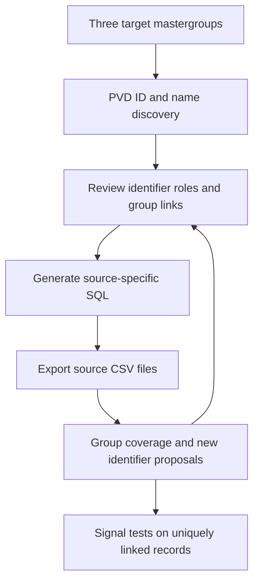

# PVD-first client cohort extraction and testing

**Portable handover:** begin with [../START_HERE.md](../START_HERE.md). The older demo/discovery instructions below describe earlier rounds. Run `cd pvd_client_cohort_lab` below from the workspace root.

**SIG07 CRR-only addition:** use [the CRR workflow](sql_templates/sig07_crr_20261104/README.md).
`sig07_crr.py` adds Application Ratings final_crr/scale and related CRR states to
the consolidated CSV. The current available-sample addition is in
`../analysis/sig07_crr_addition_20261104/`. Advisory triggers remain unverified.

**New SIG07 source, 4 November:** sample
`delta.prod_credit_and_lending_gda.application_ratings` using the
[application ratings guide](sql_templates/sig07_application_ratings_20261104/README.md).
The metadata-aware pack prepares separate sample/profile queries for all three
clients and retains S&P/CRR/other types where represented. The candidate registry
is `profiles/sig07_source_candidates.json`; live schema/key/date review precedes
runtime ingestion and any advisory trigger.

**Next extraction round:** follow [CURRENT_WORKFLOW.md](CURRENT_WORKFLOW.md).
The 3 November update adds current-snapshot SQL in `sql_templates/current_20261103/`,
effective-period Facilities selection, Delta Counterparty access, SIG01-only
missing-drawn-as-zero testing, and (development-1) SIG07 `limit_cat` candidate evidence.

**development-2, 5 November 2026:** signal rules follow the DCM meeting decisions (see
`../../docs/MEETING_ALIGNMENT_REVIEW.md` and the Rules section of CURRENT_WORKFLOW.md):

- SIG01 is a Cat A drawing above EUR 50m.
- SIG02 is dated by credit approval (`alignment.py`).
- SIG03 is split into SIG03A and SIG03B.
- SIG06 is covenant breach or half-turn pressure.
- SIG07 comes from call reports.
- Utilisation and category/CRR become `CTX_UTIL` and `CTX_CREDIT` context.
Start with that guide before the older recovery/demo instructions below.

This self-contained development package starts with **PVD OMNIA DRR**, following your preferred approach, for:

| Target mastergroup | Name supplied |
| --- | --- |
| MG001356 | VODAFONE |
| MG102229 | Siemens Energy |
| MG101624 | SOFTBANK |

It generates read-only SQL for your SQL client, analyses exported CSVs locally, builds an identifier review inventory, produces coverage tables for every group/source and runs candidate signal tests. The earlier `local_signal_lab` remains a separate package.

Python **3.10+** is the only runtime requirement. No pip packages, database server, Hadoop access or network connection are needed for the local code. SQL execution and CSV export take place through your existing SQL access; the package does not submit queries or handle credentials.

**For the manual copy/paste and drive-transfer workflow, start with [MANUAL_STARBURST_WORKFLOW.md](MANUAL_STARBURST_WORKFLOW.md).** The 2 November fixes include an array-aware KYC name query, explicit PVD ID-first queries, a wider PVD recovery window and `import-exports` for recognising downloaded files without renaming them. `candidate-sql` prepares ID-based follow-up lookups from observed source records without changing approval decisions.

## Start with the complete demonstration

```sh
cd pvd_client_cohort_lab
python3 --version
python3 cohort.py demo --out runs/demo-001
```

Use a new output name for every run. The demo creates synthetic source data and walks through PVD discovery, identifier review, discovery of CIN/GID bridges, relationship mapping, coverage and signal tests. **Do not use its approval CSVs for real data.** A completed example is also supplied in `examples/demo-run/` for immediate inspection.

Open these demo outputs:

- `runs/demo-001/01_discovery/REPORT.md`: PVD candidates; other source files missing.
- `runs/demo-001/02_bridge_discovery/identifier_review.csv`: CINs/GIDs proposed from later source records.
- `runs/demo-001/04_reviewed_coverage/coverage_summary.csv`: one summary row for each group.
- `runs/demo-001/04_reviewed_coverage/coverage.csv`: 21 rows, one per group and source.
- `runs/demo-001/05_signal_tests/results/exports/cohort_signal_summary.csv`: all six signals for each group.

On Windows, use `py -3` instead of `python3` if that is your Python launcher. Quote paths containing spaces. `run.sh` is an optional Unix launcher.

## The extraction process



**PVD is the first discovery source.** The supplied PVD schema contains `joi_relationship_id`, `drr_supergroup_id`, `joi_key` and several names. It does not contain an explicit CIN column. `joi_key` can be a composite value; the appearance of a CIN/GID-like string does not prove its namespace. Therefore the code preserves PVD identifiers as `PVD_RELATIONSHIP_ID`, `PVD_SUPERGROUP_ID` and `PVD_KEY` until reviewed. Exact equality between a seed MG ID and a PVD field is useful candidate evidence, not automatic proof of field meaning.

After reviewing PVD, DRR/CLO direct mastergroup routes and, once confirmed, Counterparty can expose CINs/GIDs for further extraction. This is supporting identifier discovery; it does not change the decision to begin with PVD.

## 1 Generate and run the PVD discovery SQL

An initial pack is provided in `sql_templates/seed/`. To generate another pack:

```sh
python3 cohort.py seed-sql \
  --start 2026-10-01 --end 2026-10-30 \
  --out generated_sql/pvd-001
```

In your Starburst/Trino SQL client:

1. Execute the statements in `01_pvd_schema.sql` separately. Confirm the live fields, native date type/format and partition properties. Export schema and DDL separately.
2. Review `02_pvd_discovery.sql`. It searches the three supplied IDs in the PVD relationship/supergroup fields and the configured aliases in `joi_relationship_name`, `omn_mastergroup_name` and `drr_supergroup_name`. Names are uppercased and punctuation/spacing normalised for candidate discovery.
3. Choose available dates and a manageable scope, then run the discovery query. Save the full result with original headers as `inputs/pvd.csv`.
4. Run `03_pvd_date_coverage.sql` for the same predicates. Its counts describe raw rows, not unique entities or facilities.
5. Copy/fill `metadata.example.json` beside the CSV as `pvd.metadata.json`. Save the exact submitted SQL, filters, requested dates, export time, row-limit/truncation status and execution outcome. Put schema/DDL/query result files outside source data chunk folders, for example under `inputs/schemas/` and `inputs/queries/`.

The supplied PVD sample only demonstrated business dates through July 2025. It does not establish the latest available source date. Adjust the extraction window using source metadata/guidance; an empty recent result needs investigation. No arbitrary LIMIT is generated, and no materiality, product or utilisation trigger is applied during raw capture. Bound queries before increasing volume; do not assume the full warehouse can be handled as one local CSV.

## 2 Analyse the first PVD export

```sh
python3 cohort.py analyse \
  --input inputs --as-of 2026-10-30 \
  --out runs/discovery-001
```

Review:

| File | Purpose |
| --- | --- |
| `REPORT.md` | Coverage interpretation and next actions. |
| `coverage_summary.csv` | One row per target group, including discovered/approved CIN/GID counts and source matches. |
| `coverage.csv` | One row per group/source: matches, candidates, conflicts, dates, identifier counts, freshness and qualifications. |
| `identifier_review.csv` | Distinct discovered identifiers with their original source column/type, evidence dates and review decision. |
| `name_variations.csv` | Original names and normalised forms, by source/group. Names remain discovery context. |
| `matches.csv` | Row-level group association, matching routes and candidate/conflict status. |
| `source_status.csv` | Files/rows, headers, missing identifier columns, invalid/future dates and absent metadata. |
| `cohort.sqlite` | Raw records, reviews, matches and coverage in one queryable local database. |

At this point PVD rows may be `candidates_only`; this is expected before identifier review. Other sources will be `missing_file`. Neither state means no client activity.

## 3 Review and approve identifiers

Copy `runs/discovery-001/identifier_review.csv` to `inputs/approved_identifiers.csv`. Preserve its exact headers and identifiers as text, including leading zeros. For each verified link:

- Set `decision` to `approve`; use `reject` for a reviewed non-match and `pending` for an unresolved link.
- Check `approved_type`. A PVD relationship ID stays `PVD_RELATIONSHIP_ID` unless you have evidence that another namespace is valid. Do not change `joi_key` to CIN simply because it looks numeric.
- Check `target_source`. PVD-native types target `pvd`. Reviewed CIN/GID/mastergroup namespaces can target `*` only when their cross-source meaning is verified. Relationship/customer/facility routes require an explicit source.
- Enter concrete verification evidence in `evidence`, for example the source dictionary/reference or the source record establishing the mapping. Approval without evidence is rejected by the code.
- Set inclusive `valid_from`/`valid_to` when the link is time-bound. Blank bounds apply the reviewed cohort link throughout the extraction window; they do not establish historical legal membership.
- For facility identifiers, provide source-system/country or CLO source-scope fields in `scope_json`. A facility ID is not a universal join key. Missing scope must be investigated, not removed to force a match.

`proposed_type` records what the original source column represents in this package. `approved_type` records the role you have verified. `origin_source`/`origin_column` preserve provenance. You can add a separately verified crosswalk as a **new row with a unique `review_id`**; copy the required column format, specify the target source and evidence. Do not reuse an existing review ID for a different identifier.

If your source knowledge confirms that a particular PVD relationship value is also a **GID**, keep its `PVD_RELATIONSHIP_ID` approval for matching PVD and add a separate verified `GID` row targeting the appropriate sources (or `*` for a verified shared namespace). The GID can then find DRR/Counterparty/CLO records and reveal their CINs. The same approach applies to a verified CIN conversion. Keeping both roles avoids losing the native PVD association when adding a cross-source route; the program never decides this from an ID prefix alone.

Example format for a **made-up, source-verified relationship bridge**:

```text
mastergroup_id: MG001356
origin_source: facilities
origin_column: relationship_id
identifier_value: DEMO_RELATIONSHIP
approved_type: RELATIONSHIP_ID
target_source: covenants
decision: approve
evidence: Reference proving these systems share this relationship ID for this group
scope_json: {}
```

This is a format example, not a mapping to enter for real clients. See `DATA_DICTIONARY.md` for all types and fields.

## 4 Generate source extracts from reviewed links

```sh
python3 cohort.py source-sql \
  --approved inputs/approved_identifiers.csv \
  --start 2026-10-01 --end 2026-10-30 \
  --out generated_sql/sources-001
```

Open `extraction_plan.csv`. A source with no approved identifier route receives a `02_BLOCKED.txt` explanation rather than an invented join. Your three target mastergroup anchors allow initial CLO/DRR queries even before all CINs have been found. Counterparty's proposed table remains gated until its location/schema/date format are confirmed.

| Source | Available identifier routes |
| --- | --- |
| PVD | Reviewed PVD relationship/supergroup/key identifiers. |
| CLO | Target mastergroup ID; reviewed CIN/GID; explicitly scoped facility/sub-limit/reference IDs. |
| DRR | Target mastergroup ID; reviewed CIN/GID, source-specific relationship or scoped facility IDs. |
| Counterparty | Target mastergroup ID; reviewed CIN/GID, after catalog/schema confirmation. |
| Facilities | Reviewed CIN, source-specific relationship/customer or scoped facility IDs. |
| KYC | Reviewed CIN. |
| Covenants | Verified source-specific relationship/facility bridges. Facility equality across systems is not assumed. |

Run `01_schema.sql` statements separately, then inspect and execute `02_extract.sql`. Run `03_date_coverage.sql` with the same conditions. `EXISTS` ensures that matching several identifiers does not multiply a source row.

Where known name columns exist, `04_name_candidates.sql` is a supplementary discovery query. Keep its results distinguishable through file/metadata provenance. It does not approve a group association. No unverified name columns were invented for Counterparty, Facilities, DRR or Covenants.

Save source results as:

```text
inputs/pvd.csv
inputs/clo.csv
inputs/drr.csv
inputs/counterparty.csv
inputs/facilities.csv
inputs/kyc.csv
inputs/covenants.csv
```

For several exports per source use `inputs/<source>/part-001.csv`, etc., with identical header order. A flat CSV and a chunk folder for the same source cannot coexist. Place schema/profile exports outside those data folders. The earlier sample filenames, including `omina_drr_samples.csv`, are also recognised. Source datasets remain separate.

Use UTF-8 CSV, headers, comma delimiter, dot-decimal numeric values and correct quoting of multiline text. Preserve original CSVs rather than saving them through a spreadsheet that may convert identifiers. `csv_delimiter` is configurable if your exporter uses another delimiter.

### Confirm Counterparty before its SQL extraction

The proposed identifier is `delta.prod_party_gda.counterparty_core`. Confirm it, its five expected matching fields and `run_date` format. Set `counterparty_catalog_confirmed` to true in this new package's configuration only after checking. Regenerate into a **new** SQL directory. The older reviewed Delta path does not establish catalog equivalence. A local CSV can be analysed while catalog confirmation remains unresolved; coverage keeps that qualification.

Unless an explicit Counterparty start date is configured, its extraction window starts `counterparty_lookback_days` before the CLO lower bound, so earlier mapping observations can support historical CLO rows. The initial 120 days comes from the previous matching configuration and still needs validation. Keep it consistent with the signal engine's mapping lookback when refining the experiment.

### Use source-specific dates

`config.json` permits per-source overrides:

```json
"source_windows": {
  "pvd": {"start": "2025-01-01", "end": "2025-07-31"},
  "drr": {"start": "2023-05-01", "end": "2023-07-31"}
}
```

Those are examples consistent with dates seen in old samples, not recommended current reporting windows. Agree actual available periods before use. Coverage retains mixed dates and marks stale records rather than presenting them as a complete current snapshot.

## 5 Repeat coverage as the cohort expands

```sh
python3 cohort.py analyse \
  --input inputs --approved inputs/approved_identifiers.csv \
  --as-of 2026-10-30 --out runs/coverage-002
```

Direct source mastergroup matches and reviewed identifiers can expose additional CIN/GID/relationship IDs. These appear as **pending proposals**. Review them, carry forward the updated review CSV, generate a new SQL pack and repeat. Existing approvals/manual bridges are retained in the next review export; `observed_rows=0` means an inventory item was retained but not observed in the current inputs. Reject obsolete mappings explicitly or bound their dates.

The original three target groups remain fixed. Sharing a PVD supergroup, a similar name or a bridge into a different mastergroup does not silently expand the cohort. Conflicting approved links or disagreement with an explicit source mastergroup are quarantined. No source record is assigned to two groups as a confirmed match.

Historical Counterparty/CLO/DRR rows can propose former or inactive entity identifiers. Review lifecycle, observation dates and mapping validity before approving their reuse. Finding a historical group association does not establish current group membership.

## 6 Run the signal tests on linked data

```sh
python3 cohort.py run-signals \
  --cohort runs/coverage-002 \
  --out runs/signals-001
```

Only uniquely linked rows enter the bundled local signal engine; candidate/conflict rows remain in the cohort review database. The new folder includes its own runtime copy, so the old `local_signal_lab` does not need to be installed or present.

Inspect:

- `runs/signals-001/results/REPORT.md` and `validation.json`: field, history, amount/currency and source-quality checks.
- `results/exports/cohort_signal_summary.csv`: **18 rows**, one per group and retained signal.
- `results/exports/cohort_signal_evidence.csv`: metric/context, source provenance, cohort group and mapping qualifications.
- `results/exports/clo_enriched.csv`: original/final Counterparty enrichment evidence.
- `results/bond_radar.sqlite`: raw/derived tables, plus cohort group lineage views.
- `cohort_row_groups.csv`: trace from signal-input row numbers back to the cohort database.

`engine/config.json` defaults to unverified business definitions. It does not infer PVD currency, financial covenant meaning, EUR conversion, HSBC participation or ratings-advisory activity. SIG03 has no source; SIG05 is excluded. Leave `triggered` blank where evidence or definitions are unverified. You may pass `--engine-config` with a reviewed experiment configuration, keeping the default file available.

For testing, approved CIN/GID/PVD routes can use `COHORT_GROUP:<MG>` client grouping keys. These are deliberately **group-level test keys**, not a claim that all entities share one legal identity. Original identifiers remain in raw records. `cohort_mastergroup_id` is a separate lineage-derived field; original CLO/Counterparty mastergroups are not overwritten by the cohort adapter. Shared facilities spanning groups remain unallocated rather than counted in each group.

## Coverage interpretation

`coverage.csv` includes every combination of the configured groups and the seven sources. It distinguishes missing file, empty export, no match in supplied data, candidates only, mapping conflict, linked records and stale linked records. It records both raw and distinct-row counts, CINS/GIDs/relationship IDs found on matched rows, match/candidate date ranges and metadata gaps. `raw_export_rows`, `invalid_dates`, `future_rows` and `metadata_missing` describe the whole source export and therefore repeat on each group row.

Discovered identifiers and reviewed identifiers are separate. Dates are source observations, not automatically relationship-effective dates. Missing exports and unverified links are unavailable evidence; coverage does not establish absence of activity or a complete subsidiary roster. No coverage percentage is invented without an independently verified expected population. No financial totals are summed across overlapping sources.

`freshness_days=45` is a development setting, not an agreed source service level. The configured membership policy describes a reviewed discovery cohort; historical membership must be verified separately through dated mappings. As-of checks exclude future observations and available processing dates but cannot recover historical versions absent from the source export.

## Tests and troubleshooting

```sh
python3 -m unittest discover -s tests -v
python3 -m unittest discover -s engine/tests -v
```

- Existing output: choose a new directory; successful runs are never overwritten.
- No source query: read `02_BLOCKED.txt`; approve the missing identifier route or verify the catalog.
- All PVD rows candidate-only: review identifier type/group association. The code deliberately does not reinterpret ID prefixes or name matches as verified links.
- No CINs found in PVD: expected from the supplied schema; use later DRR/Counterparty/CLO records to propose CINs.
- Lost leading zeros or malformed CSV: correct the upstream export; the program cannot reconstruct identifiers already changed by another application.
- Blank triggers: expected until relevant business definitions are confirmed; inspect computed metrics and reasons.
- Future/invalid dates: retained raw, excluded from matching; review date types and processing-time semantics.
- Very large exports: use manageable bounded client/date slices. Raw ingestion/coverage and signal handoff use disk-backed data and streaming; distinct ID inventories and one extremely large facility/date group still require memory.

Exit code 0 means the diagnostic process completed with its reported qualifications. Exit code 2 means invalid input/configuration or an operational failure. Partial runs/logs are retained in a hidden staging directory for diagnosis. SQL generation never establishes remote execution success.

See `DATA_DICTIONARY.md` for output definitions and `VALIDATION.md` for the checks performed. Trino syntax references used for the SQL generators: [VALUES](https://trino.io/docs/current/sql/values.html), [regular expression functions](https://trino.io/docs/current/functions/regexp.html), [SELECT](https://trino.io/docs/current/sql/select.html).
